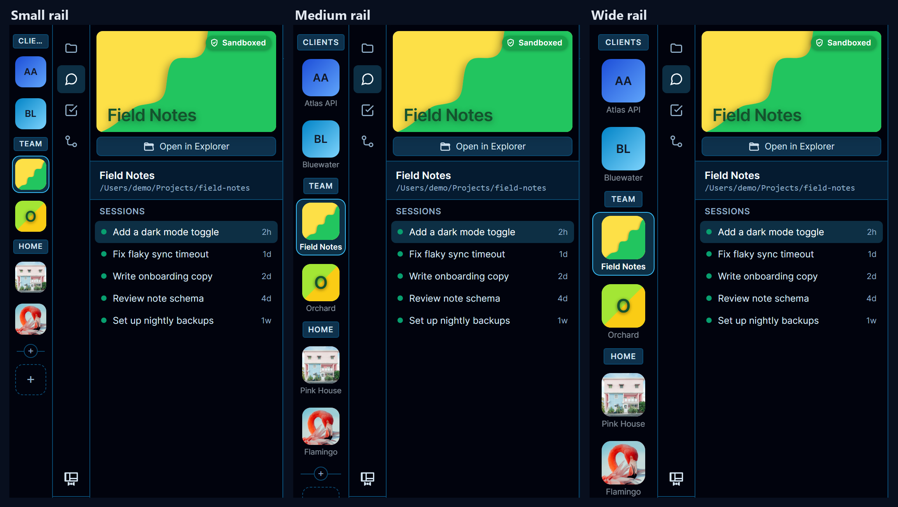
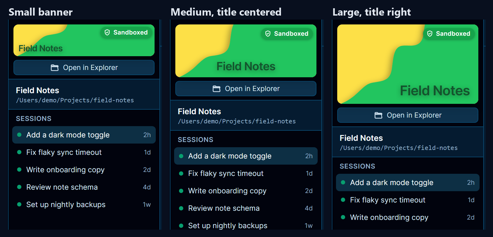
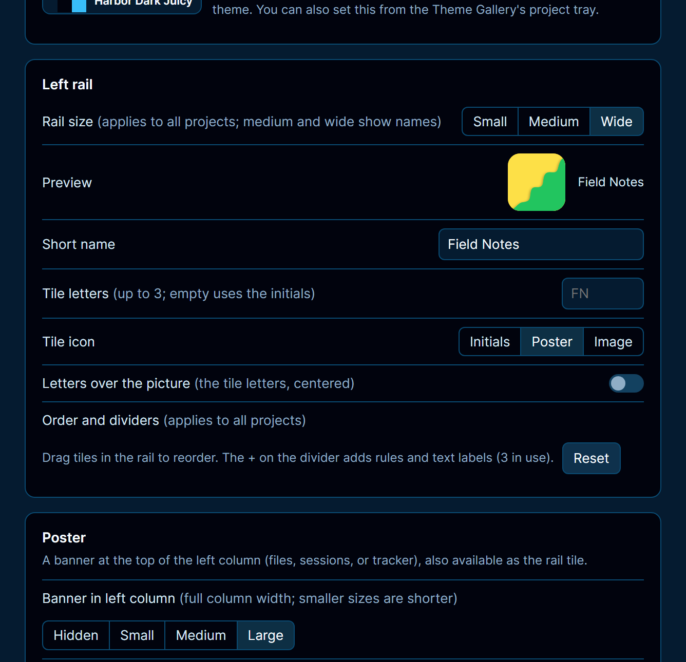
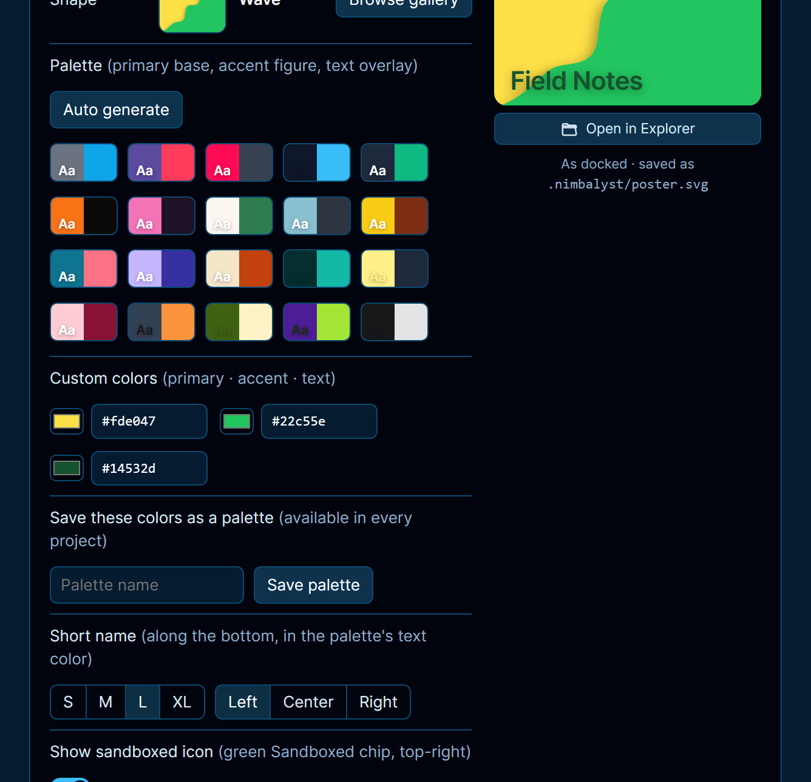

<picture>
  <source media="(prefers-color-scheme: dark)" srcset="docs/images/logo-white.svg">
  
</picture>

# Mr. Projects

Make each project in [Nimbalyst](https://nimbalyst.com) look like itself: a project rail with names and icons, a poster at the top of the sidebar, and, with [Mr. Themes](https://github.com/Firework-Labs/nimbalyst-mr-themes), its own color theme.

<picture>
  <source media="(prefers-color-scheme: light)" srcset="screenshots/com.fireworklabs.project-theme-0-light.png">
  
</picture>

- Drag projects into your own order and group them with lines and headings
- Pick a poster per project: a shape, a pattern, or your own image
- Optional Sandboxed badge and Open in Finder (Explorer on Windows) button
- Settings live in the project (`.nimbalyst/project-theme.json`), so they travel with it

<picture>
  <source media="(prefers-color-scheme: light)" srcset="screenshots/com.fireworklabs.project-theme-1-light.png">
  
</picture>

## What's new in this fork

This is [MG007Raiser's fork](https://github.com/MG007Raiser/nimbalyst-mr-projects) of [Firework-Labs/nimbalyst-mr-projects](https://github.com/Firework-Labs/nimbalyst-mr-projects). It keeps the same extension id, so your settings carry over.

**0.6.0**

- **Rail size:** Small, Medium or Wide. Medium is new: bigger icons with one-line names.
- **Tile letters:** pick up to three letters for a project's tile (say `G` for GitHub) and keep them over a poster or image tile.
- **Banner size:** Small, Medium or Large, or hidden. The banner stays full width and gets shorter.
- **Short name:** an XL size, and left, center or right alignment.
- **Palettes:** twenty built-ins instead of ten, and an Auto generate button for a new random palette on each click.
- **Images:** Browse buttons for the image tile and the image poster, which copy the file into the project. Image URLs work too, with Save a copy to download them. Animated GIFs play in the banner and on the tile.





 

**0.5.2:** image tiles and image posters work on Windows, and a broken tile image retries once the path is fixed.

## Install

In Nimbalyst's extension Marketplace, scroll to **Install from GitHub** and paste this fork's address:

```
https://github.com/MG007Raiser/nimbalyst-mr-projects
```

Uninstall the original Mr. Projects first if you have it. The original is at `https://github.com/Firework-Labs/nimbalyst-mr-projects`.

Install [Mr. Themes](https://github.com/Firework-Labs/nimbalyst-mr-themes) the same way for per-project themes.

## Good to know

Mr. Projects swaps in its own rail and adds the poster using parts of Nimbalyst that aren't in its extension API, so a Nimbalyst update can break them until Mr. Projects catches up. Turning it off brings back Nimbalyst's own rail. More in [docs/details.md](docs/details.md).

MIT license. Patterns from [Hero Patterns](https://heropatterns.com) by Steve Schoger.
